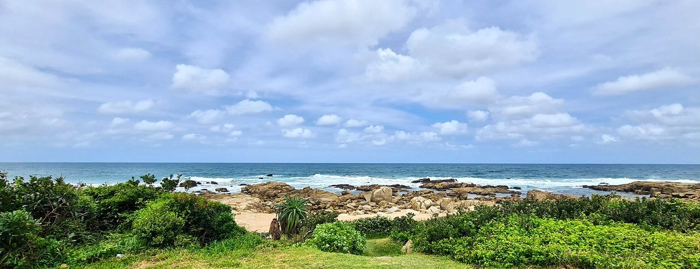
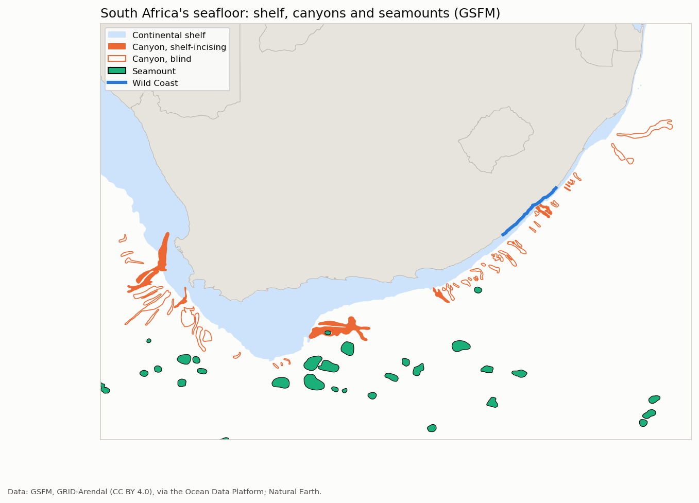
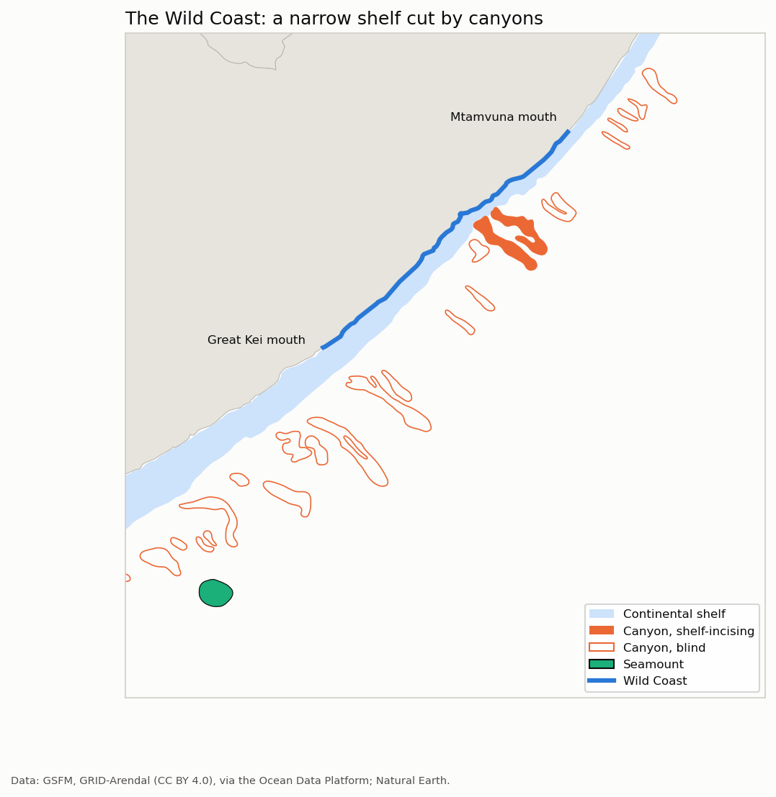
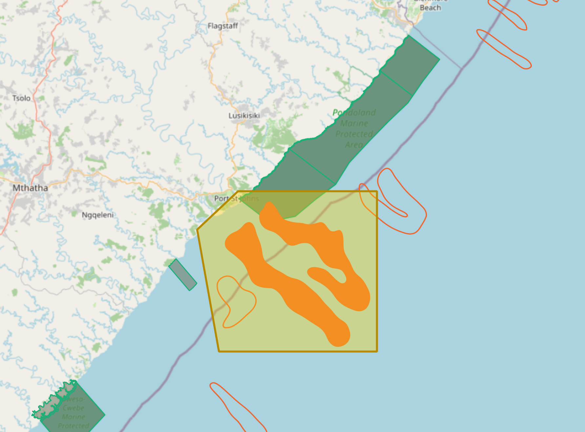

---
hide:
  - navigation
  - toc
---

# ODP Academy, Working with Ocean Data on ODP

<header class="cover bleed">
  
  

    
ODP Academy · November to December 2026

    <h2>Working with Ocean Data, from the coast I grew up on</h2>
    
My progress in HUB Ocean's course on the Ocean Data Platform, and what one question about the Wild Coast seafloor led to.

    
Linda Angulo Lopez · updated 22 November 2026

    Scroll to read ↓
  

  Photo: the Indian Ocean at Margate, KwaZulu-Natal South Coast, by <a href="https://www.flickr.com/photos/65695019@N07/54280264565">Bernard Dupont</a> (CC BY-SA 2.0), via Flickr.
</header>

I am following [*Working with Ocean Data on ODP*](https://www.hubocean.earth/odp-academy-wiomsa-training), a free online course from [HUB Ocean](https://www.hubocean.earth/), [WIOMSA](https://www.wiomsa.org/) (the Western Indian Ocean Marine Science Association) and [SeaSketch](https://www.seasketch.org/). It runs from 12 November to 18 December 2026, 2 to 4 hours a week, with a new module every Thursday. The lessons are on ODP Academy; the data is on the [Ocean Data Platform](https://app.hubocean.earth/) (ODP).

This site shows where I am, module by module. It is a log, so it will change.

Where I start from

## A botanist from the Wild Coast

I grew up on the Wild Coast in South Africa, on the Indian Ocean, and trained as a botanist. I am a Full Stack GIS Developer, with more than 25 years of work across Europe and Africa in environmental governance, landscape ecology and research infrastructures. Since September 2025 I have been a Partnerships Specialist at Software Heritage. More about me on [my personal site](https://lindangulopez.github.io/personal_knowledge_base/).

QGIS and Python are daily tools for me; ocean data is newer.

Module 2 exercise

## The Wild Coast seafloor

For a Module 2 lesson I downloaded ODP's global seamount layer, and found no seamount anywhere near the coast I grew up on. So I asked: **what does the Wild Coast's seafloor have instead, and how does it compare with the rest of South Africa's coast?**

<section class="sidecar" markdown="1">
  <figure class="side-media">
    
    <figcaption>South Africa's shelf, canyons and seamounts, with the Wild Coast highlighted. Data: Seafloor Geomorphic Features Map, GRID-Arendal (CC BY 4.0), via ODP.</figcaption>
  </figure>
  

### Four reaches, 302 points

I split South Africa's mainland coast into four reaches (West, South, Wild Coast, KwaZulu-Natal) and placed a point every 10 km along it. At each point I measured the distance to the nearest seamount and the width of the shelf, and I counted the canyons within 100 km of the coast.

### Four open layers

The seamounts, canyons, shelf and slope come from the Seafloor Geomorphic Features Map on ODP, read through its OGC API Features with no key. The code is a [notebook](https://github.com/lindangulopez/odp-academy-2026/blob/main/notebooks/wild_coast_seafloor.ipynb); the method and its limits are on the [exercise page](module-2-wild-coast.md).

  

</section>

  
<strong>~190 km</strong>to the nearest seamount from the Wild Coast

  
<strong>14 km</strong>median shelf width, against 76 km on the South coast

  
<strong>3.2</strong>canyons per 100 km of coast, the most in South Africa

  
<strong>6.4 km</strong>from shore to the closest canyon, the closest in the country

<section class="sidecar flip" markdown="1">
  <figure class="side-media">
    
    <figcaption>The Wild Coast close up: a narrow shelf, with canyons just offshore.</figcaption>
  </figure>
  

### Canyons, not seamounts

The hypothesis holds. The Wild Coast's shelf is a narrow strip; only KwaZulu-Natal is as narrow. Two shelf-incising canyons come within 8 km of shore. Its deep-sea features are canyons cutting towards the coast, not seamounts.

### What it cannot say

A narrow shelf brings the Agulhas Current and deep water close to the coast, and canyons can channel deep water and nutrients towards the shelf. Whether that shapes the Wild Coast's marine life, for example around the Pondoland Marine Protected Area, is a question this geomorphology alone cannot answer.

  

</section>

<figure class="wide bleed">
  
  <figcaption>Lab 2, <em>Map my place</em>: the two shelf-incising canyons off Port St Johns (filled orange) inside my place (yellow), just south of the Pondoland Marine Protected Area (green). Data: GSFM canyons, GRID-Arendal (CC BY 4.0); ProtectedSeas Navigator V2 (CC BY 4.0), via ODP; basemap © OpenStreetMap contributors.</figcaption>
</figure>

## Where it led

Starting from a global seamount file, I found that the Wild Coast has none nearby, and went looking for what it has instead: canyons. My Lab 2 place is the Port St Johns canyons, just outside the Pondoland MPA. After the course, I plan a short [Zenodo article](learning-path.md#after-the-course-a-zenodo-article) on the Wild Coast seafloor.

[Read the ArcGIS story map](https://storymaps.arcgis.com/stories/4a21fdf0c85140f9b3fb6b648d483599){ .md-button .md-button--primary }
[The full exercise](module-2-wild-coast.md){ .md-button }
[Lab 2 in Module 2](module-2-gis.md#lab-2-port-st-johns-canyons){ .md-button }

The course at a glance

## Five steps to the certificate

There is a certificate for each module, and one for the whole course if all four modules are done by **Friday 18 December**. The dates and the closing webinar are on [Learning path](learning-path.md).

Tue 3 Nov

#### [Welcome and Sign-up](welcome.md)

ODP account, the three areas of ODP, QGIS or ArcGIS installed.

Done, 4 of 4 lessons

Fri 13 Nov

#### [1. Explore](module-1-explore.md)

Finding and looking at ocean data in the ODP Catalog.

Done

Thu 19 Nov

#### [2. GIS](module-2-gis.md)

ODP data in QGIS or ArcGIS, Lab 2: Map my place.

Done, certificate 22 Nov

Thu 26 Nov

#### [3. Code](module-3-code.md)

Notebooks in an ODP Workspace, Python or R.

Not open yet

Thu 3 Dec

#### [4. Plan](module-4-plan.md)

Marine spatial planning in SeaSketch.

Not open yet

Status

## The log

22 November 2026, late
**Module 2 done**, certificate issued by HUB Ocean. Next, after the course: a Zenodo article on the Wild Coast seafloor, over the holidays. See [Learning path](learning-path.md#after-the-course-a-zenodo-article).

22 November 2026, night
*From Download to Map* done in QGIS and in ArcGIS Online, 6 of 8 lessons. Lab 2 drawn: [Port St Johns canyons](module-2-gis.md#lab-2-port-st-johns-canyons), just outside the Pondoland MPA; upload to ODP next.

22 November 2026, evening
The Wild Coast exercise as an [ArcGIS story map](https://storymaps.arcgis.com/stories/4a21fdf0c85140f9b3fb6b648d483599).

22 November 2026, afternoon
Module 2 exercise, [The Wild Coast seafloor](module-2-wild-coast.md). The Wild Coast has no seamount within about 190 km; instead it has one of South Africa's narrowest shelves (median 14 km) and the most submarine canyons per 100 km of coast, the closest within 7 km of shore. Four ODP layers, a notebook, and QGIS. *Data formats and connections* and *Installing QGIS* done: 4 of 8 lessons.

22 November 2026
Started [Module 2: GIS](module-2-gis.md). The first two lessons, *Welcome to GIS* and *Choose your tool: QGIS or ArcGIS*, are done. I am on *Data formats and connections*, with a global seamount dataset downloaded as CSV, GeoJSON and Parquet for its assignment.

Week of 9 November
Signed up, finished *Welcome and Sign-up* and [Module 1: Explore](module-1-explore.md).

12 November 2026
Opening webinar (recorded).

Which format would you reach for first with ocean data: a file you download, or a live connection?

