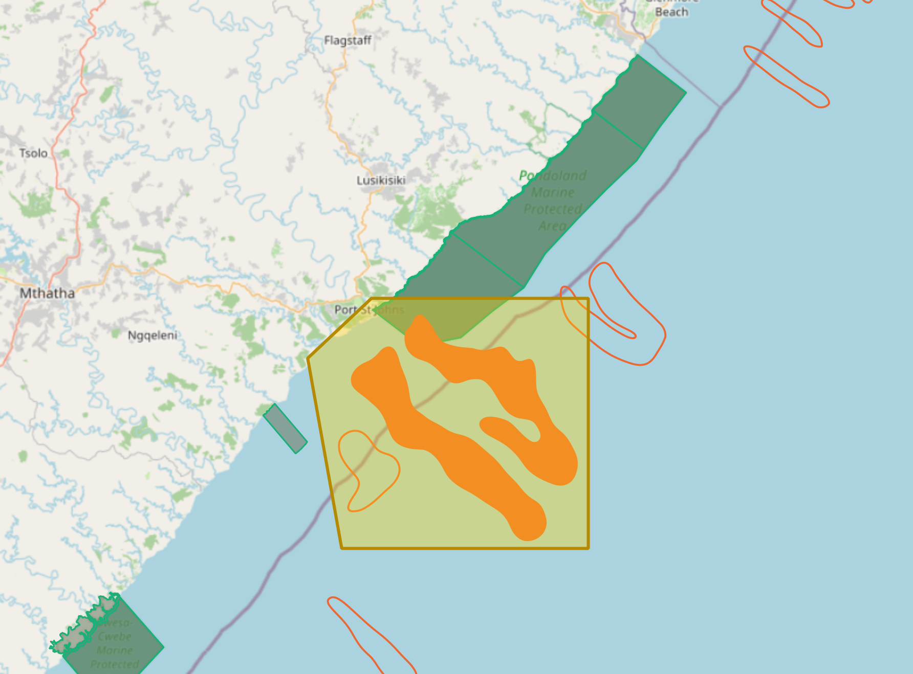

# Learning path

The course runs from 12 November to 18 December 2026, 2 to 4 hours a week. A new module opens every Thursday. I work on it in the evenings and at weekends, alongside two other courses, so it comes third in my week: what matters is all four modules by 18 December.

| When | Course | What I do | Output |
| --- | --- | --- | --- |
| **Week of 9 Nov** | Sign-up, then Module 1 opens Fri 13 Nov | ODP account; Welcome and Sign-up; Module 1: Explore | Welcome and Module 1 done |
| **Thu 12 Nov** | Opening webinar | Timeline, groups and how ODP works | Watched |
| **Sun 22 Nov** | Module 2: GIS (opened Thu 19 Nov) | All eight lessons, [the Wild Coast exercise](module-2-wild-coast.md) and Lab 2 | **Module 2 certificate, 22 Nov** |
| **26 Nov to 2 Dec** | Module 3: Code opens Thu 26 Nov | The Module 3 notebooks | Module 3 certificate |
| **3 Dec to 9 Dec** | Module 4: Plan opens Thu 3 Dec | Module 4 in SeaSketch | Module 4 certificate |
| **Thu 10 Dec** | Closing webinar, 10:00-11:30 Paris | Watch the recording if I can't attend | Watched |
| **By Fri 18 Dec** | Course closes | Anything left | Full course certificate |
| **24 Dec to 3 Jan** | After the course | [A Zenodo article](#after-the-course-a-zenodo-article) | A DOI |

## After the course: a Zenodo article

The Wild Coast exercise answered a real question, so I want it citable: a short article on Zenodo with a DOI, with the notebook and data archived alongside it. There is no rush. I write it during the Christmas and New Year holidays, from **24 December 2026 to 3 January 2027**, about seven hours in all.

It is also a test of something I care about at work: how an analysis made with ODP data can be versioned, cited and archived.

| Step | About | What | Output |
| --- | --- | --- | --- |
| **1. Draft** | 2 h | The question, data, method, results, the Lab 2 finding and the limits, in Markdown in this repository. The [Wild Coast](module-2-wild-coast.md) and [Module 2](module-2-gis.md) pages are the starting point. | `article/` draft |
| **1b. Evidence for the proposal** | 2 h | Three ODP layers clipped to the Port St Johns canyons: cold-water coral habitat suitability (Tong et al. 2023), fishing effort (Global Fishing Watch, 2024) and species records (OBIS). Then the context: how the Pondoland MPA zones were drawn, and South Africa's commitment to protect 30% of its ocean by 2030. | Evidence table |
| **2. Ready to cite** | 2 h | A licence for the code, CC BY 4.0 for the derived data in `outputs/` (as for the sources), `CITATION.cff`, `codemeta.json`, and the notebook re-run from a clean kernel. | Repository ready |
| **3. Publish** | 1 h | (i) A GitHub release with the Zenodo integration, for a DOI on the code and data; (ii) the repository archived in Software Heritage, with its SWHID; (iii) the article on Zenodo as a report, linked to the release DOI and the SWHID. | Article DOI |

Then the DOI goes on this site, the [story map](https://arcg.is/1GHyu43) and my personal site.

**What the article will say.** The Wild Coast has no seamount within 190 km, and no small seamount within 345 km. Instead it has one of South Africa's narrowest shelves (median 14 km) and the most submarine canyons per 100 km of coast, two of them within 8 km of shore. Those two canyons lie just outside the Pondoland Marine Protected Area.

**What it will propose.** That the Pondoland MPA be extended south, to include the two shelf-incising canyons off Port St Johns. The article starts where my Module 2 work went: from a global seamount file, to the canyons the Wild Coast has instead, to my Lab 2 place.

<small>Data: GSFM canyons, GRID-Arendal (CC BY 4.0); ProtectedSeas Navigator V2 (CC BY 4.0), via the Ocean Data Platform; basemap © OpenStreetMap contributors.</small>

The proposal stands only on evidence, so step 1b tests it. Shape alone is not enough: a boundary is argued on habitat, use and pressure. If the evidence is weak, the article says so, and the proposal becomes a question for the people who manage and live from this coast. Results from Modules 3 and 4 go in only if they change that story.

## If the plan breaks

- **A week is lost.** The course gives one more week after the closing webinar: everything can still close on 18 December.
- **The holidays fill up.** The article moves to January: it has no deadline, and the analysis is already public.

## How I will know it worked

By 18 December: (i) four module certificates and the course certificate, (ii) one map of my place made from ODP data (done, [Lab 2](module-2-gis.md#lab-2-port-st-johns-canyons)), (iii) one notebook that runs in an ODP Workspace. After the holidays: (iv) the Zenodo article, with a DOI and a SWHID.
