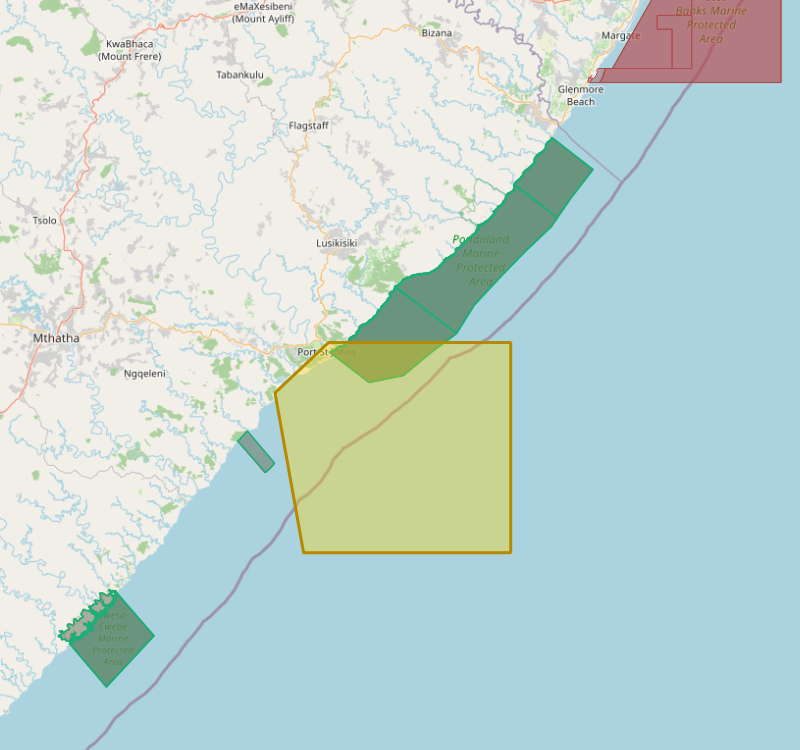
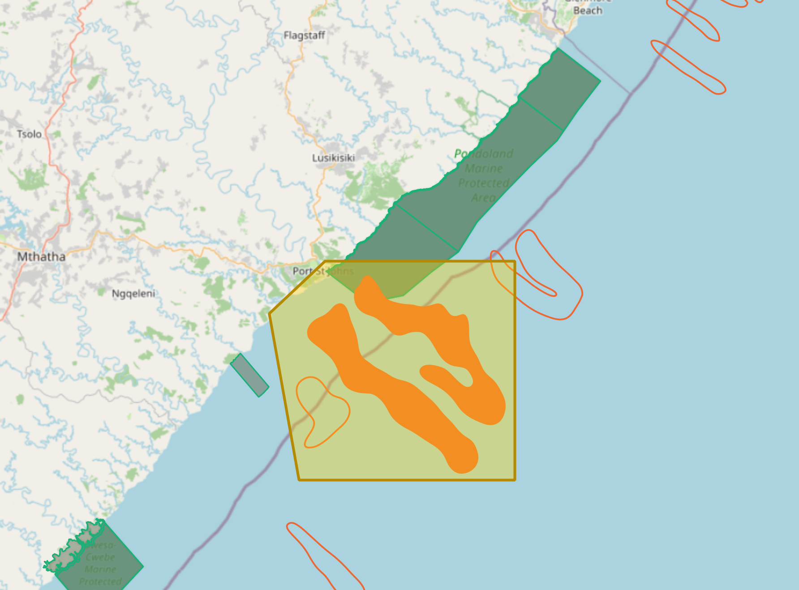

# Module 2: GIS

**Done, 22 November 2026**, certificate issued by HUB Ocean the same day. Opened on Thursday 19 November. Next: a [Zenodo article](learning-path.md#after-the-course-a-zenodo-article) on the Wild Coast exercise, over the holidays.

What I made in this module:

- [The Wild Coast seafloor](module-2-wild-coast.md), the exercise: a notebook and QGIS, on four ODP layers
- [The Wild Coast seafloor](https://arcg.is/1GHyu43), the same story as an ArcGIS story map
- [From Download to Map in ArcGIS Online](module-2-arcgis-online.md), a tutorial for the ArcGIS lesson without an ArcGIS Pro licence
- [Lab 2: Port St Johns canyons](#lab-2-port-st-johns-canyons), my place

## Lessons

### Start here

- [x] Welcome to GIS
- [x] Choose your tool: QGIS or ArcGIS (I use QGIS)
- [x] Data formats and connections, with an assignment (submitted)

### GIS: QGIS

- [x] Installing QGIS
- [x] From Download to Map (QGIS): done on the Wild Coast layers, through the QGIS MCP plugin. See [the QGIS steps](module-2-wild-coast.md#the-same-exercise-in-qgis).

### GIS: ArcGIS

- [x] From Download to Map (ArcGIS), written for ArcGIS Pro. Without a desktop licence, I did it in the browser and wrote it up: [From Download to Map in ArcGIS Online](module-2-arcgis-online.md).

My ArcGIS Online maps: [small seamounts, live from ODP](https://scgismaps.maps.arcgis.com/apps/mapviewer/index.html?webmap=392eafedff6e4d2ba1a970ae3a322d47) and a first quick test, [test-ODP](https://scgismaps.maps.arcgis.com/apps/mapviewer/index.html?webmap=d3ca11ce0490483a8960d364291a1f6a).

### Lab 2 and wrap-up

- [x] Lab 2: Map my place, uploaded to ODP on 22 November.
- [x] Final Remarks

## Lab 2: Port St Johns canyons

The lab has three steps: download the protected areas for your country, draw your place in a GIS, and upload it to your own ODP dataset as `my_place.geojson`, with two fields, **name** and **why**.

**Step 1, protected areas.** From *ProtectedSeas Navigator V2, Focused: Area-Based Protections* on ODP, I took South Africa's 252 areas, then kept those on the Wild Coast: **23 zones in four marine protected areas**, Amathole (its Kei zone), Dwesa-Cwebe, Hluleka and Pondoland. ODP's country filter returned the whole world, so I filtered by area and then by the `country` field.

**Step 2, my place, in QGIS (route A).** An OpenStreetMap basemap, ProtectedSeas connected live twice, as vector tiles and through OGC API Features, and a `my_place` layer drawn off Port St Johns, about 50 km across.

<small>Data: ProtectedSeas Navigator V2 (CC BY 4.0) via the Ocean Data Platform; basemap © OpenStreetMap contributors.</small>

- **name:** Port St Johns canyons
- **why:** Two submarine canyons cut the narrow shelf within 8 km of the shore here, just outside the Pondoland Marine Protected Area, near the coast where I grew up.

**What I found.** The two canyons that come closest to the Wild Coast's shore lie just south of the Pondoland MPA. Only 7% of one is inside it, and none of the other.

**Step 3, done 22 November.** I uploaded `my_place.geojson`, with the Wild Coast layers, to a new ODP dataset, *Wild Coast seafloor and protected areas (Group 21 - Linda)*. It is private to me and my course group.

The files are in [`outputs/lab2/`](https://github.com/lindangulopez/odp-academy-2026/tree/main/outputs/lab2) and [`outputs/wild_coast_protected_areas.geojson`](https://github.com/lindangulopez/odp-academy-2026/blob/main/outputs/wild_coast_protected_areas.geojson). Protected areas: Navigator Data Download, ProtectedSeas®, accessed 22 November 2026 from the [Ocean Data Platform](https://app.hubocean.earth/catalog/dataset/a608f54b-75c7-4df9-a3a8-cedbfa391873).

Three things I learned on the way, for anyone doing Lab 2:

- The ProtectedSeas **vector-tile link** works in QGIS as `https://api.hubocean.earth/api/table/v2/tile/a608f54b-75c7-4df9-a3a8-cedbfa391873?z={z}&x={x}&y={y}`.
- For the **OGC API Features** connection, tick *only request features overlapping the view extent*, or QGIS loads the whole world.
- The `my_place` layer is temporary until you save it: export it before you close QGIS, as the lab says.

## Notes: data formats and connections

ODP data comes as files, and a GIS can also connect to it live.

| Format | Best suited for |
| --- | --- |
| **CSV** | General tables. It opens in any spreadsheet, but it is not the best choice for maps. |
| **GeoJSON** | Shapes and their attributes in one file. It opens directly in QGIS, geojson.io and most web maps. Used in Lab 2. |
| **Parquet** | Compact and fast for large tables. Used in the Code module. |

Not every dataset offers every format; the dataset page shows which ones it has.

**Three ways to read ODP data in a GIS**, all on open standards, so the same data works in QGIS, ArcGIS, web maps and SeaSketch:

1. **Download** a file from the dataset page, or from the Explore table after filtering. A copy that works anywhere, offline too. Best for small or filtered data.
2. **OGC API Features**: a live connection to the shapes and their data. One connection gives every dataset you can see on ODP. Best when you need only your own area of a large dataset.
3. **Vector tiles**: map tiles that draw fast at any zoom. Best for looking at very large datasets, not for analysis. ODP's Map Explorer is built on them.

In short: look with vector tiles, then take your area with a filtered download or OGC API Features. The links are under *Use Dataset* on each dataset page. Open data needs no login or key; private datasets need your API key from your ODP account page.

## The dataset I downloaded: global seamounts

For the assignment I downloaded one ODP dataset in all three formats. It is a global layer of **9,951 seamounts**, all polygons (31 of them multipolygons), from 75° S to 77° N. Each seamount has an ID, a peak depth (2 to 7,589 m, median 2,314 m), a height above the seafloor (953 to 7,570 m) and an area (3 to 15,509 km², median 592 km²). It is the seamount layer of the *Seafloor Geomorphic Features Map* by GRID-Arendal (CC BY 4.0), from Harris et al. (2014), as its ODP catalogue record confirms.

The same 9,951 seamounts take three different sizes:

| File | Size | How the shapes are stored |
| --- | --- | --- |
| CSV | 9.2 MB | One text column, `geometry`, with each polygon written as WKT, `POLYGON ((lon lat, …))` |
| GeoJSON | 10.8 MB | A `FeatureCollection`: each seamount is a feature with its geometry as nested coordinate arrays, and its attributes under `properties` |
| Parquet | 6.1 MB | Binary and compressed, column by column |

**Where it led.** Starting from this global seamount file, I found that the Wild Coast has none nearby, and went looking for what it has instead: canyons. The view below is my Lab 2 project in QGIS. The two shelf-incising canyons (filled orange) lie inside my place off Port St Johns (yellow), just south of the Pondoland Marine Protected Area (green).

<small>Data: GSFM canyons, GRID-Arendal (CC BY 4.0); ProtectedSeas Navigator V2 (CC BY 4.0), via the Ocean Data Platform; basemap © OpenStreetMap contributors.</small>
