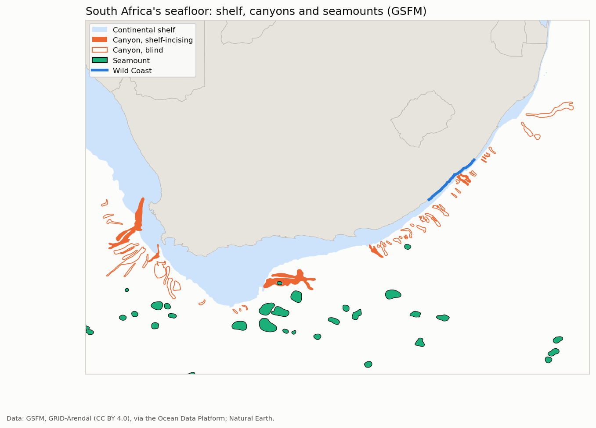
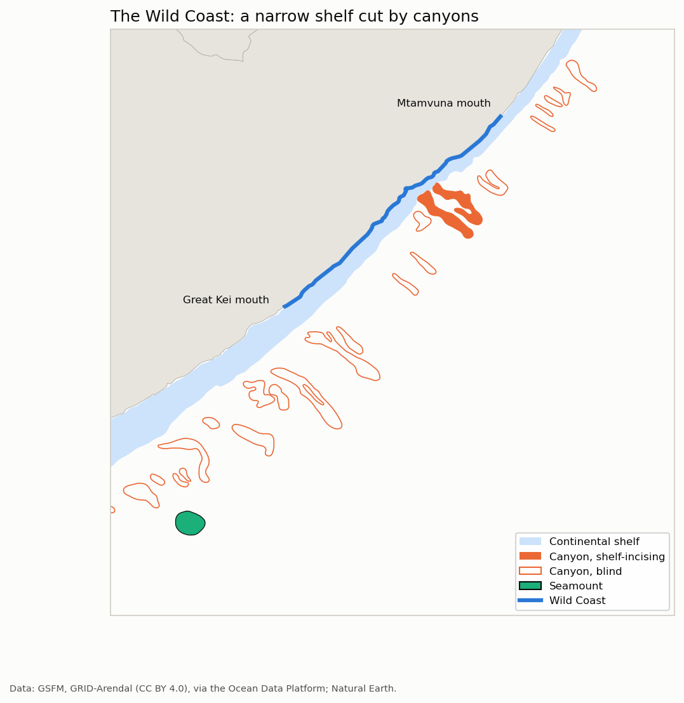
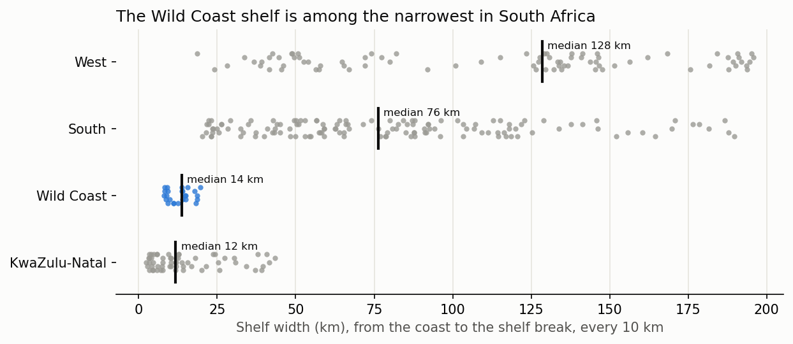
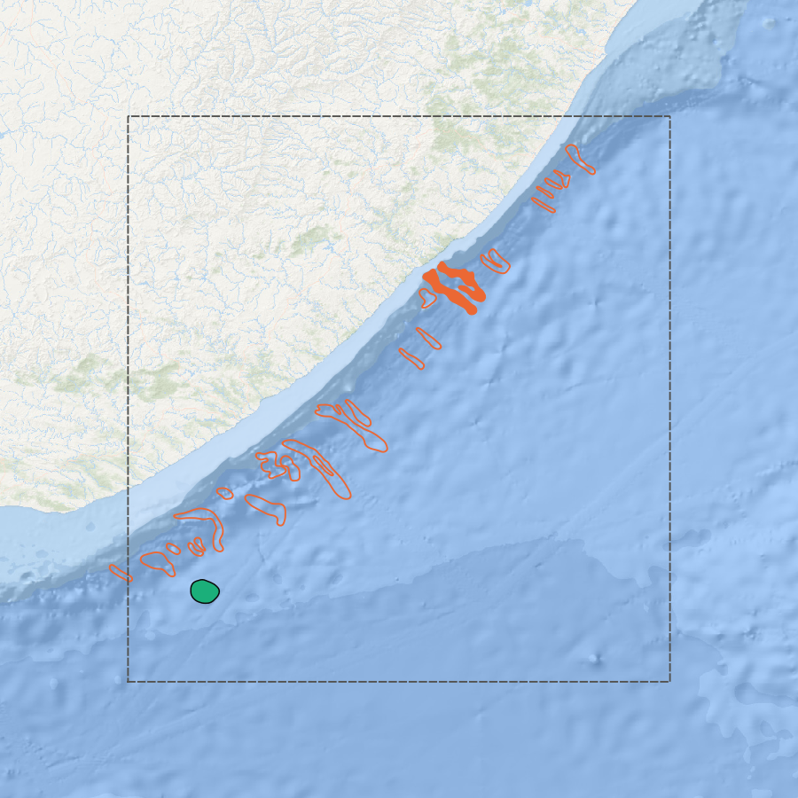

# The Wild Coast seafloor

**Module 2 exercise, 22 November 2026.** ODP data, in a notebook and in QGIS, to answer one question about a coast I know.

The short version, as an ArcGIS story map: [The Wild Coast seafloor](https://storymaps.arcgis.com/stories/4a21fdf0c85140f9b3fb6b648d483599).

## The question

I grew up on the Wild Coast, the stretch of South Africa's Eastern Cape from the Great Kei River mouth to the Mtamvuna River mouth. For the *Data formats and connections* lesson I downloaded ODP's global seamount layer, and found no seamount within 100 km of this coast.

So: **the Wild Coast has no seamounts nearby. What does its seafloor have instead, and how does it compare with the rest of South Africa's coast?**

My hypothesis was that the Wild Coast has one of the narrowest shelves in the country, with submarine canyons cutting close to shore, while the seamounts sit far offshore.

## Data

Four layers of the **Seafloor Geomorphic Features Map (GSFM)** on ODP, by GRID-Arendal (CC BY 4.0), from Harris et al. (2014), [*Geomorphology of the oceans*](https://doi.org/10.1016/j.margeo.2014.01.011), Marine Geology 352: 4-24:

| Layer | ODP dataset |
| --- | --- |
| Seamounts | [027a6438-…](https://app.hubocean.earth/catalog/dataset/027a6438-2d81-4a6e-91f3-e939e79f7cdd) |
| Canyons | [f9ac8c35-…](https://app.hubocean.earth/catalog/dataset/f9ac8c35-68f8-4c4c-b033-86188608507d) |
| Shelf | [9dc7ec46-…](https://app.hubocean.earth/catalog/dataset/9dc7ec46-f1db-482f-81aa-c5957296525e) |
| Slope | [ac8739f5-…](https://app.hubocean.earth/catalog/dataset/ac8739f5-f616-488e-b23f-e6a715868cba) |

They are open data, read through ODP's OGC API Features with no key. The coastline is from [Natural Earth](https://www.naturalearthdata.com/) 1:10m.

## Method

I split South Africa's mainland coast into four reaches: West (Orange River to Cape Point), South (Cape Point to the Great Kei), Wild Coast (Great Kei to Mtamvuna) and KwaZulu-Natal (Mtamvuna to Kosi Bay). I placed a point every 10 km along the coast, 302 points in all, and measured:

1. the distance to the nearest seamount;
2. the shelf width: the distance to the continental slope, which starts at the shelf break;
3. the canyons within 100 km of the coast: how many, how many per 100 km of coast, and how close they come to shore.

Distances are in Africa Albers Equal Area, accurate to within a few percent at this scale. The code is in [`notebooks/wild_coast_seafloor.ipynb`](https://github.com/lindangulopez/odp-academy-2026/blob/main/notebooks/wild_coast_seafloor.ipynb).

## Results

| Reach | Coast sampled (km) | Nearest seamount (km) | Median shelf width (km) | Canyons | Canyons per 100 km | Closest canyon to shore (km) |
| --- | ---: | ---: | ---: | ---: | ---: | ---: |
| West | 820 | 222 | 129 | 5 | 0.6 | 18.8 |
| South | 1,350 | 97 | 76 | 17 | 1.3 | 30.2 |
| **Wild Coast** | **250** | **192** | **14** | **8** | **3.2** | **6.4** |
| KwaZulu-Natal | 600 | 423 | 12 | 7 | 1.2 | 16.3 |

## What it says

The hypothesis holds. The Wild Coast has no seamount within about 190 km. Its shelf is a narrow strip, a median of 14 km, against 76 km on the South coast and 129 km on the West coast; only KwaZulu-Natal is as narrow. Canyons come closer to shore here than anywhere else in South Africa, two shelf-incising canyons within 8 km, and the Wild Coast has the most canyons per 100 km of coast. Its deep-sea features are canyons cutting towards the shore, not seamounts.

A narrow shelf brings the Agulhas Current and deep water close to the coast, and canyons can channel deep water and nutrients towards the shelf. Whether that shapes the Wild Coast's marine life, for example around the Pondoland Marine Protected Area, is a question this geomorphology alone cannot answer.

## Limits

- The GSFM is a global map built from about 1 km bathymetry: small canyons and local detail are missing. The numbers compare reaches; they are not survey results.
- I chose the reach boundaries; moving them a few kilometres changes the counts a little.
- Geomorphology only. Ecology, the Agulhas Current and the MPA need more data, for Module 3 (Code) and Module 4 (Plan).

## The same exercise in QGIS

I followed the lesson *From Download to Map (QGIS)* step by step in QGIS 3.34, driven through the [QGIS MCP](https://github.com/nkarasiak/qgis-mcp) plugin with Claude.

1. **Download as GeoJSON.** The global seamount file from ODP, 9,951 features.
2. **Into QGIS**, over the Esri World Ocean Base map.
3. **Large layers as a live connection.** Canyons and Shelf as OGC API Features layers from `https://api.hubocean.earth/api/features`.
4. **Onto the map**, all layers in one project.
5. **Area of interest.** A box off the Wild Coast (27.0-31.6° E, 35.2-30.4° S), then *select by location* and *save selected features*. The shelf is one ocean-wide polygon, so I clipped it to the box instead.
6. **Restyle and reorder**: the shelf in light blue, canyons in orange (filled when shelf-incising), seamounts in aqua.
7. **Remove the global layers**, keeping the area-of-interest layers and the basemap.
8. **Make the scratch layers permanent**: each saved as GeoJSON in [`outputs/qgis/`](https://github.com/lindangulopez/odp-academy-2026/tree/main/outputs/qgis).

<small>Basemap: Esri World Ocean Base (Esri, GEBCO, NOAA, National Geographic, Garmin, HERE and other contributors). Data: GSFM, GRID-Arendal, CC BY 4.0, via ODP.</small>

QGIS and the notebook agree: the box holds **1 seamount and 24 canyons** in both.

Three things I learned on the way:

- **A live connection can be silently incomplete.** With default settings, each OGC API Features layer from ODP loaded exactly 1,000 features, while the canyon layer has 9,477. Setting a page size of 10,000 in the connection loaded them all. Check the feature count against the dataset page.
- **ODP's `bbox` filter returned features from outside the box** when I tested it from Python, so I clipped after downloading.
- **The shelf layer has an invalid polygon** (feature 1708). *Clip* refused it until I ran *Fix geometries* first.

## Clipped layers

Small GeoJSON files, in WGS84, for QGIS and for ODP's My Data, in [`outputs/`](https://github.com/lindangulopez/odp-academy-2026/tree/main/outputs): `sa_seamounts`, `sa_canyons_near_coast` (with each canyon's reach and distance to shore), `sa_coast_points` (with the seamount distance and shelf width at each point) and `sa_shelf`.
